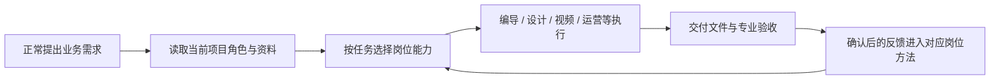

# 新媒体营销数字员工 Skill

> **把团队的审美、经验和交付标准，装进一个可安装、可协作、可持续改进的 Codex Skill。**

**一个入口 · 14 项岗位能力 · 按项目自动选用 · 开源可迁移**

Portable Codex skill for new-media teams: content planning, design, video production, operations and skill governance.

[快速开始](#快速开始) · [看一次完整协作](#一条需求如何被处理) · [下载固定版本](https://github.com/lanwenlong75-cpu/szyg-new-media-marketing/releases/tag/v0.2.7-public.2026.10.31.1) · [查看能力版本](SOURCE-VERSIONS.json)

---

你可能遇到过：同一条口播，在一台电脑上剪得对味；把 Skill 装到另一台电脑，节奏、字幕、画面却变了。原因往往是判断方法、参考工程、字体和验收要求散落在不同地方，安装时只带走了其中一部分。

这个项目把**岗位方法、风格选择、制作工具和验收规则**收进一个统一入口。接入项目后，你照常提出需求，Codex 会先识别当前项目的角色和资料，再按任务读取需要的能力。新媒体主管负责跨岗位交接、版本核对与方法同步；你的客户、账号、产品和素材仍由你自己的项目提供。

## 本次更新

**统一发行号：2026.10.31.1。** 新增三项编导初始标准：改写时保持选题与落点、区分原作者经历与产品植入、口播开头直接给判断。按当前任务的采用条件使用，用户明确指定的开头与结构优先。

GitHub附件与微信发送的本地安装包使用同一发行号，同宿主包字节一致。Codex与WorkBuddy共用同一公开岗位方法快照，分别适配安装入口；旧版及其附件保留。原始反馈、身份、业务资料和本机配置不随包分发。

## 它能帮你做什么

| 你提出的需求 | 会用到的能力 | 重点保留的标准 |
|---|---|---|
| “这条口播帮我剪好，封面和校对材料也准备好” | 编导、视频制作引擎、新媒体运营 | 原声与重说判断、字幕、视觉路线、封面对应核验、版本与审阅材料 |
| “把这个观点做成公众号文章和小红书笔记” | 公众号编辑、小红书运营、海报设计 | 平台表达、事实来源、图文结构和当前项目的视觉要求 |
| “把课程资料变成能讲、能练的课件” | 课件打造师、产品经理、海报设计 | 教学目标、逐页脚本、练习评价和可编辑交付 |
| “让这些岗位以后按同一套方法配合” | 新媒体主管、数字员工搭建师 | 岗位路由、交接、反馈迭代与适用副本同步 |

这套 Skill **保留多种创作风格**，也保存选择风格的判断。剪辑时会结合本期素材、原稿和项目规则决定路线，并把字体、模板、参数和验收结果留在工程里，方便复查和迁移。

## 一条需求如何被处理



例如你说：“这段口播有几次重说，做一版竖屏精剪，保留真人和原声，给我字幕、封面和校对入口。”已接入项目中的 Codex 会读取当前素材和要求，按需采用编导、视频制作引擎与运营方法；完成后分别核对语义取舍、声画、字幕、封面和交付版本。**安装成功只说明方法已就位，真实成片仍以这次素材的听校和观看结果为准。**

下面是包内的匿名技术示意，用于展示能力形式；它们不代表某位使用者的真实业务成片。

| 视频动效示意 | 可编辑课件示意 |
|:---:|:---:|
|  |  |

## 14 项能力，一个入口

| 工作环节 | 内部能力 |
|---|---|
| 统筹与治理 | 新媒体主管 `SUPERVISOR` |
| 内容与产品 | 短视频编导 `DIRECTOR`、公众号编辑 `EDITOR`、小红书运营 `XHS`、产品经理 `PRODUCT`、课件打造师 `COURSEWARE` |
| 视觉与视频 | 海报设计师 `DESIGNER`、视频制作引擎 `MOTION` |
| 运营与承接 | 新媒体运营 `OPS`、私域顾问 `PRIVATE` |
| 技术与搭建 | 全栈工程师 `ENGINEER`、数字员工搭建师 `BUILDER` |
| 资料归档 | 单条视频归档 `ARCHIVE_VIDEO`、账号作品归档 `ARCHIVE_ACCOUNT` |

仓库只有一个可发现的 [`SKILL.md`](skills/szyg-new-media-marketing/SKILL.md)。岗位方法位于 `capabilities/<能力ID小写>/GUIDE.md`，按任务读取。你在**已接入的项目**里正常提需求即可，无需每次指定入口或先挑岗位。

## 快速开始

### 1. 选择使用的软件，发送同版压缩包和提示词

当前只认**总发行号 2026.10.31.1**。微信分发保留版本号和宿主名，后续更新时发送新版，旧包归档。

| 使用的软件 | 完整安装包 | 微信发送时的文件名 |
|---|---|---|
| WorkBuddy | [下载WorkBuddy离线总包](https://github.com/lanwenlong75-cpu/szyg-new-media-marketing/releases/download/v0.2.7-public.2026.10.31.1/szyg-new-media-marketing-workbuddy-2026.10.31.1.zip) | 新媒体数字员工_2026.10.31.1_WorkBuddy版.zip |
| Codex | [下载Codex完整包](https://github.com/lanwenlong75-cpu/szyg-new-media-marketing/releases/download/v0.2.7-public.2026.10.31.1/szyg-new-media-marketing-codex-2026.10.31.1.zip) | 新媒体数字员工_2026.10.31.1_Codex版.zip |

两个宿主包的岗位方法相同。只向对方发送其使用的软件对应的包和下面的提示词；WorkBuddy总包里包括Skill ZIP和Windows Python运行时。完整解压总包，内层Skill ZIP用于WorkBuddy“添加技能 → 上传技能”，按实际客户端完成安全检查和确认。

**给WorkBuddy：**

```text
请帮我把《新媒体数字员工_2026.10.31.1_WorkBuddy版.zip》安装或升级到WorkBuddy。完整解压并按包内说明完成技能导入、十四个岗位工作区的创建和检查，保留我已有的资料与本地改进。需要我操作界面时告诉我具体步骤；完成后告诉我实际安装版本、使用入口和缺少的工具。
```

**给Codex：**

```text
请帮我把《新媒体数字员工_2026.10.31.1_Codex版.zip》安装或升级到Codex。完整解压并按包内说明安装统一Skill、创建并检查十四个岗位工作区，保留已有资料和本地改进。完成后告诉我实际安装版本、使用入口和缺少的工具。
```

希望由Codex直接联网下载时，可复制[在线安装提示词](INSTALL-PROMPT.md)，也可[下载Windows在线启动器](https://github.com/lanwenlong75-cpu/szyg-new-media-marketing/releases/download/v0.2.7-public.2026.10.31.1/Install-New-Media-Team-Windows.cmd)。GitHub不可达时，由发送者提供本地完整包。

### 2. 选择自己的岗位工作区

安装回执会列出团队实际目录、Skill入口和缺少的工具。WorkBuddy查看START-HERE-WorkBuddy.md，Codex查看START-HERE.md。首次添加项目或选择工作区时，使用回执中的真实目录。项目显示名可填“数字员工-新媒体主管”“数字员工-短视频编导”“数字员工-课件打造师”等，聊天或任务名填写本次交付。

改显示名时保持磁盘绑定路径；搬迁文件夹时先迁移注册表与项目配置，再检查。已有不同版本或本地方法先备份和比对迁移，不能直接覆盖。源包更新不会自动改动已经装到别人电脑上的版本。

### 3. 发出真实任务

```text
请读取当前项目配置和新媒体营销总入口，按我的真实资料完成接下来的任务，先检查岗位绑定和需要的工具。服务对象和账号先保持为空。
```

包内审美、经验、模板与标准继续使用；技术安装、宿主实际调用、专业成品验收分别确认。完整说明见[开始使用](开始使用.md)。

## 这套方法从哪里来

它来自持续的多岗位内容生产与跨电脑交付复盘：把有效的审美判断、失败纠正、版式参数、模板、工具和验收要求沉淀为可读取的方法。新媒体主管维护能力注册和版本关系，让改进落到对应岗位，再同步给适用的副本。

公开版保留可迁移的方法，排除了原使用者身份、客户与账号资料、产品事实、私有照片和视频、凭据及反馈原文。课件示意重新制作成匿名、可编辑的样例。你的业务事实、授权素材与品牌选择始终来自你自己的项目。

当前公开发行对应总入口 **0.2.7**、14 项能力；视频制作引擎源版本为 **3.14.0-rc.1**。各岗位版本与源/公开入口摘要见[版本清单](SOURCE-VERSIONS.json)。本机隔离安装、14 岗位路由和匿名剪辑技术样例已验证；接收电脑的工具环境、真实口播听校和审美认可需要用实际素材完成。完整范围见[验收与边界](验收与边界.md)。

## 一起完善

如果你也在用 Codex 做内容团队协作，欢迎通过 [Issues](https://github.com/lanwenlong75-cpu/szyg-new-media-marketing/issues) 提交可复现的问题、适用场景和改进建议。请先移除客户原文、账号凭据和私有素材。觉得这套方法有用，可以给项目一个 Star，让更多需要稳定交付标准的人找到它。

本仓库原创整合文件采用 [MIT License](LICENSE)；第三方方法、字体和视频引擎按各自许可证使用，见[第三方说明](THIRD_PARTY.md)。
