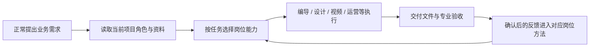
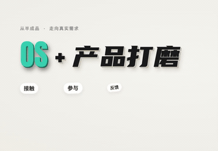
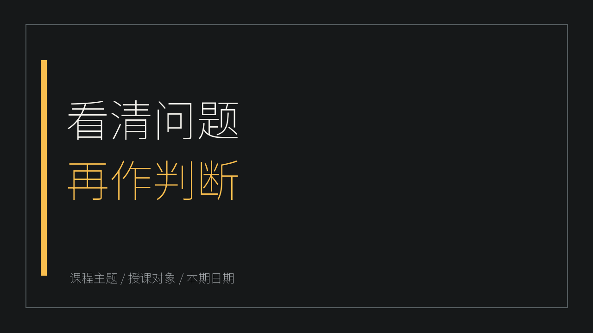

# 新媒体营销数字员工 Skill

> **把团队的审美、经验和交付标准，装进一个可安装、可协作、可持续改进的 Codex Skill。**

**一个入口 · 14 项岗位能力 · 按项目自动选用 · 开源可迁移**

Portable Codex skill for new-media teams: content planning, design, video production, operations and skill governance.

[快速开始](#快速开始) · [看一次完整协作](#一条需求如何被处理) · [下载固定版本](https://github.com/lanwenlong75-cpu/szyg-new-media-marketing/releases/tag/v0.2.7-public.2026.10.24.1) · [查看能力版本](SOURCE-VERSIONS.json)

---

你可能遇到过：同一条口播，在一台电脑上剪得对味；把 Skill 装到另一台电脑，节奏、字幕、画面却变了。原因往往是判断方法、参考工程、字体和验收要求散落在不同地方，安装时只带走了其中一部分。

这个项目把**岗位方法、风格选择、制作工具和验收规则**收进一个统一入口。接入项目后，你照常提出需求，Codex 会先识别当前项目的角色和资料，再按任务读取需要的能力。新媒体主管负责跨岗位交接、版本核对与方法同步；你的客户、账号、产品和素材仍由你自己的项目提供。

## 本次更新

`2026.10.24.1` 同步海报57项参考目录、公众号文章四维拆解与编导营销方法；新增 Windows 一键安装、自动准备 Python、十四岗位工作区创建与项目命名指引。完整变化见 [发行变更](CHANGELOG.md)。总入口仍为0.2.7，各模块源版本与摘要分别记录。

## 它能帮你做什么

| 你提出的需求 | 会用到的能力 | 重点保留的标准 |
|---|---|---|
| “这条口播帮我剪好，封面和校对材料也准备好” | 编导、视频制作引擎、新媒体运营 | 原声与重说判断、字幕、视觉路线、封面对应核验、版本与审阅材料 |
| “把这个观点做成公众号文章和小红书笔记” | 公众号编辑、小红书运营、海报设计 | 平台表达、事实来源、图文结构和当前项目的视觉要求 |
| “把课程资料变成能讲、能练的课件” | 课件打造师、产品经理、海报设计 | 教学目标、逐页脚本、练习评价和可编辑交付 |
| “让这些岗位以后按同一套方法配合” | 新媒体主管、数字员工搭建师 | 岗位路由、交接、反馈迭代与适用副本同步 |

这套 Skill **保留多种创作风格**，也保存选择风格的判断。剪辑时会结合本期素材、原稿和项目规则决定路线，并把字体、模板、参数和验收结果留在工程里，方便复查和迁移。

## 一条需求如何被处理



例如你说：“这段口播有几次重说，做一版竖屏精剪，保留真人和原声，给我字幕、封面和校对入口。”已接入项目中的 Codex 会读取当前素材和要求，按需采用编导、视频制作引擎与运营方法；完成后分别核对语义取舍、声画、字幕、封面和交付版本。**安装成功只说明方法已就位，真实成片仍以这次素材的听校和观看结果为准。**

下面是包内的匿名技术示意，用于展示能力形式；它们不代表某位使用者的真实业务成片。

| 视频动效示意 | 可编辑课件示意 |
|:---:|:---:|
|  |  |

## 14 项能力，一个入口

| 工作环节 | 内部能力 |
|---|---|
| 统筹与治理 | 新媒体主管 `SUPERVISOR` |
| 内容与产品 | 短视频编导 `DIRECTOR`、公众号编辑 `EDITOR`、小红书运营 `XHS`、产品经理 `PRODUCT`、课件打造师 `COURSEWARE` |
| 视觉与视频 | 海报设计师 `DESIGNER`、视频制作引擎 `MOTION` |
| 运营与承接 | 新媒体运营 `OPS`、私域顾问 `PRIVATE` |
| 技术与搭建 | 全栈工程师 `ENGINEER`、数字员工搭建师 `BUILDER` |
| 资料归档 | 单条视频归档 `ARCHIVE_VIDEO`、账号作品归档 `ARCHIVE_ACCOUNT` |

仓库只有一个可发现的 [`SKILL.md`](skills/szyg-new-media-marketing/SKILL.md)。岗位方法位于 `capabilities/<能力ID小写>/GUIDE.md`，按任务读取。你在**已接入的项目**里正常提需求即可，无需每次指定入口或先挑岗位。

## 快速开始

### 1. 安装并创建自己的员工团队

**Windows 推荐：[下载一键安装器](https://github.com/lanwenlong75-cpu/szyg-new-media-marketing/releases/download/v0.2.7-public.2026.10.24.1/Install-New-Media-Team-Windows.cmd)。** 保存这个 `.cmd` 文件后双击，等待窗口提示完成；无需先装 Git，也无需手动输入命令。前提是已安装并登录 Codex，网络能访问 GitHub；缺少 Python 时还会访问 python.org。

安装器会下载本固定发行的完整包、核对 GitHub 提供的 SHA-256，优先使用电脑已有 Python；缺少时自动准备官方便携 Python，随后安装 Skill、创建 **14 个岗位工作区**、运行环境预检并打开团队文件夹。打开其中的 **`START-HERE.md`**，里面有你这台电脑的实际路径和可复制的第一条需求。

也可 [下载完整 ZIP](https://github.com/lanwenlong75-cpu/szyg-new-media-marketing/releases/download/v0.2.7-public.2026.10.24.1/szyg-new-media-marketing-codex-2026.10.24.1.zip)，**完整解压**后双击 `Install-Codex-Windows.cmd`。macOS / Linux 可把下方安装指令交给 Codex，或按[开始使用](开始使用.md)运行 Python 安装器。

默认团队位置是用户主目录下的 `数字员工团队/Codex新媒体`，里面有 `新媒体主管`、`短视频编导`、`公众号编辑`、`海报设计师`、`课件打造师`等目录。每个岗位有独立知识、任务和反馈目录，初始服务对象与账号为空。这个步骤创建磁盘工作区；首次加入 Codex 侧栏时，继续下面一步选择文件夹。

### 2. 在 Codex 里创建项目，命名成员工列表

先在 Codex 的项目入口新建或添加一个**本地项目**，添加安装后生成的实际文件夹。可以先只添加团队根目录，命名为“我的数字员工团队”，让主管统筹；也可以像下面这样逐岗添加。

| 项目名称可填写 | 选择的实际文件夹 |
|---|---|
| 数字员工-新媒体主管 | `数字员工团队/Codex新媒体/新媒体主管` |
| 数字员工-短视频编导 | `数字员工团队/Codex新媒体/短视频编导` |
| 数字员工-公众号编辑 | `数字员工团队/Codex新媒体/公众号编辑` |
| 数字员工-海报设计师 | `数字员工团队/Codex新媒体/海报设计师` |
| 数字员工-小红书运营 | `数字员工团队/Codex新媒体/小红书运营` |
| 数字员工-产品经理 | `数字员工团队/Codex新媒体/产品经理` |
| 数字员工-课件打造师 | `数字员工团队/Codex新媒体/课件打造师` |

其他岗位用同样的方法添加。选择该岗位目录作为项目主文件夹，然后在这个项目里新建聊天。后续添加或调整文件夹可从项目菜单的“编辑项目 / Edit project”进入；当前版本入口与文字以界面为准。参见 [OpenAI 项目说明](https://learn.chatgpt.com/docs/projects)。

**重命名时区分三处：** 项目名称是侧栏标签，聊天标题是项目里的某次任务名，磁盘文件夹是资料和绑定的实际位置。新建时可直接填写上表名称；已有项目从名称旁菜单的“重命名 / 编辑项目”调整显示名称，具体入口以当前版本为准。保持已绑定文件夹不变。需要改磁盘目录名或搬位置时，先让主管迁移注册表与路径配置，再运行检查。

### 3. 发出第一条需求

在“数字员工-新媒体主管”项目新建聊天，复制：

```text
请读取本项目配置和新媒体营销总入口，检查十四项能力与岗位绑定，告诉我缺哪些工具。接下来按我的真实资料完成任务，服务对象和账号先保持为空，不套用别人的品牌或案例。
```

后续直接说“帮我策划这条短视频”“把这份资料做成课件”等实际需求即可。项目里可以开多条聊天：项目名用岗位，聊天名用本次交付，例如“规划下月选题”。Skill 列表未刷新时先新建聊天，仍未出现再重新打开 Codex。

<details>
<summary>让 Codex 代为安装 / 自定义安装位置 / 接入已有项目</summary>

把这段交给 Codex：

```text
请安装 https://github.com/lanwenlong75-cpu/szyg-new-media-marketing 的固定发行 2026.10.24.1。
完整下载并读取开始使用.md，运行包内安装器校验文件，初始化我自己的团队和岗位工作区。
已有同名 Skill、本地改进或业务目录时先比对合并并保留资料，完成后把 START-HERE.md 的实际路径告诉我。
```

Windows 自定义位置（从完整解压目录执行）：

```powershell
powershell.exe -NoProfile -ExecutionPolicy Bypass -File .\install.ps1 -WorkspaceRoot "D:\我的数字员工团队"
```

macOS / Linux 已有 Python 3.10+ 时：`python3 install.py --archive-legacy`。

已有项目请让 Codex 使用已安装 Skill 的 `scripts/portable.py bind --project-root <现有目录> --role <岗位ID> --governance-root <团队/新媒体主管>` 接入，再运行 `scripts/hub.py check --project-root <现有目录>`。示例岗位ID：`EDITOR`公众号、`DIRECTOR`编导、`DESIGNER`海报、`COURSEWARE`课件。

已有统一入口的跨版本升级或本地改进会触发保护，请交给 Codex 比对迁移；保留已学方法和原业务目录。完整说明见[开始使用](开始使用.md)。

</details>

安装完成后，按真实任务补齐 FFmpeg、Node、浏览器、转写环境或图像工具；它们不随一键安装自动全部配置，详见[接收电脑自检](SELF-TEST.md)。

## 这套方法从哪里来

它来自持续的多岗位内容生产与跨电脑交付复盘：把有效的审美判断、失败纠正、版式参数、模板、工具和验收要求沉淀为可读取的方法。新媒体主管维护能力注册和版本关系，让改进落到对应岗位，再同步给适用的副本。

公开版保留可迁移的方法，排除了原使用者身份、客户与账号资料、产品事实、私有照片和视频、凭据及反馈原文。课件示意重新制作成匿名、可编辑的样例。你的业务事实、授权素材与品牌选择始终来自你自己的项目。

当前公开发行对应总入口 **0.2.7**、14 项能力；视频制作引擎源版本为 **3.14.0-rc.1**。各岗位版本与源/公开入口摘要见[版本清单](SOURCE-VERSIONS.json)。本机隔离安装、14 岗位路由和匿名剪辑技术样例已验证；接收电脑的工具环境、真实口播听校和审美认可需要用实际素材完成。完整范围见[验收与边界](验收与边界.md)。

## 一起完善

如果你也在用 Codex 做内容团队协作，欢迎通过 [Issues](https://github.com/lanwenlong75-cpu/szyg-new-media-marketing/issues) 提交可复现的问题、适用场景和改进建议。请先移除客户原文、账号凭据和私有素材。觉得这套方法有用，可以给项目一个 Star，让更多需要稳定交付标准的人找到它。

本仓库原创整合文件采用 [MIT License](LICENSE)；第三方方法、字体和视频引擎按各自许可证使用，见[第三方说明](THIRD_PARTY.md)。
